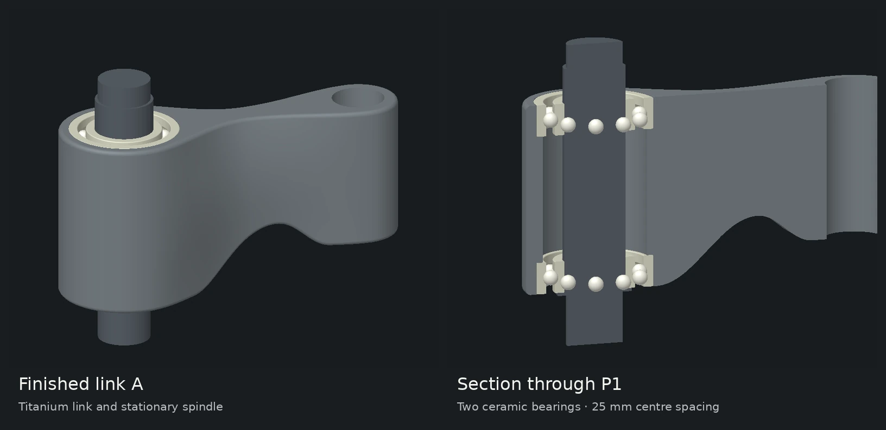

# P1–P2 titanium link · R2

CAD study for the two Alien LT horizontal link lengths. Use A or B to match the guide geometry. Dimensions are in millimetres. The local Z-axis passes through the stationary P1 pivot. P2 lies along +X.

| Model | P1–P2 axis spacing | Nominal finished CAD | Titanium printing blank |
| --- | ---: | --- | --- |
| A | 42.30346 mm | [Finished A](p1-p2-link-a-r2.step) | [Stock A](p1-p2-link-a-r2-stock.step) |
| B | 37.00000 mm | [Finished B](p1-p2-link-b-r2.step) | [Stock B](p1-p2-link-b-r2-stock.step) |

The 30 mm P1 sleeve houses two full ceramic 10 × 19 × 5 mm bearings with 25 mm between their centres. The [stepped spindle](p1-spindle-r2.step) is a nominal turning model for the fixed upper and lower supports. The P2 interface retains its 9 mm bore. [Model construction](p1-link-r2.pseudo) · [CAD view and section](p1-link-section.webp)

Use a stock file for a machining trial. The stock leaves 0.30 mm radially in the bearing seats and P2 bore, and 0.25 mm for the local faces and bearing shoulders. Measure the actual bearings and establish final fits, shoulder contact and axial retention before machining. The running torque and dynamics of the physical assembly remain unmeasured. The white annuli in the section represent the bearing envelopes.

## Inspect the P1 bearings

[Open the P1 bearing view](https://lab.engroveaudio.com/modules/lt-mechanism/?camera=p1-bearings)

| STEP assembly | Contents |
| --- | --- |
| [Single bearing](p1-bearing-10x19x5-reference.step) | Two grooved rings and ten individually named balls, centred at the origin |
| [Link A with bearings](p1-link-a-with-bearings.step) | Finished titanium link A, stepped spindle and both bearings |
| [Link B with bearings](p1-link-b-with-bearings.step) | Finished titanium link B, stepped spindle and both bearings |

The lower and upper bearings are centred at Z25 and Z50. The owner supplied the 10 mm bore, 19 mm outside diameter, 5 mm width and full-ceramic description. The internal construction is illustrative. The reference uses ten balls of diameter 2.381 mm from the [NSK 6800 catalogue](https://www.nsk.com/ph-en/engineering/products/bearings/ball-bearings/deep-groove-ball-bearings/single-row-deep-groove-ball-bearings/6800-apn.html). Pitch diameter, race profiles and edge radii are modelling assumptions. Cage geometry, running clearance and the ball complement of the owner's bearings await identification. The drawing omits the cage. Use the separate stock links above for printing.
